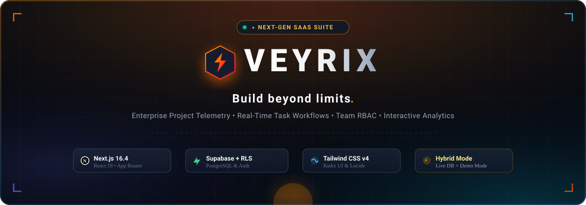

<div align="center">



<br/><br/>

# ⚡ Veyrix

**Build beyond limits.**  
A modern, high-performance B2B SaaS project management & analytics platform.

[](https://nextjs.org/)
[](https://react.dev/)
[](https://www.typescriptlang.org/)
[](https://tailwindcss.com/)
[](https://supabase.com/)
[](LICENSE)

[Live Demo](#-live-demo) • [Features](#-key-features) • [Tech Stack](#-tech-stack) • [Getting Started](#-getting-started) • [Database Setup](#-database-setup)

</div>

---

## 📌 Overview

**Veyrix** is an enterprise-grade SaaS platform built for engineering teams, agile startups, and modern businesses. It combines real-time project tracking, task execution workflows, team role management, interactive analytics, and billing pipelines into a unified, responsive dashboard.

Designed with a **hybrid architecture**, Veyrix functions seamlessly in both:
1. **Live Production Mode** — Backed by Supabase PostgreSQL with Row Level Security (RLS) & Auth.
2. **Interactive Showcase Mode** — Runs out-of-the-box with seeded mock data and offline interactivity for effortless portfolio demonstrations and recruiter reviews.

---

## ✨ Key Features

- 📊 **Executive Analytics Dashboard (`/`)**
  - High-level KPIs: Active Projects, Completed Tasks, Latency, and Error Rates.
  - Interactive charts powered by Recharts with dynamic time-range filters.
  - Real-time audit log and activity streams.

- 📁 **Project Management (`/projects`)**
  - Create, view, update, and filter projects across workspaces.
  - Environment badges (`Production`, `Staging`, `Preview`) and priority tagging (`High`, `Medium`, `Low`).

- ✅ **Task Execution & Workflow (`/tasks`)**
  - Track deliverables across `Todo`, `In Progress`, and `Done` states.
  - Due dates, assignee tags, and priority markers.

- 👥 **Team & Role-Based Access Control (`/team`)**
  - Multi-tier membership roles: `Owner`, `Admin`, and `Member`.
  - Secure permission checks and member invitation management.

- 💳 **Subscription & Billing Center (`/billing`)**
  - Tiered plan comparisons (`Starter`, `Pro`, `Scale`).
  - Invoice history and resource allocation trackers.

- ⌨️ **Command Palette (`Cmd + K` / `Ctrl + K`)**
  - Global spotlight search to instantly jump between projects, tasks, settings, and documentation.

- 🔐 **Robust Authentication & Middleware (`/login`, `/register`)**
  - Server-side cookie session validation with Next.js Middleware and `@supabase/ssr`.
  - Automatic redirection for protected and guest routes.

- 🌓 **Theme Engine**
  - Seamless Light and Dark modes with persistent user preference storage.

---

## 🛠️ Tech Stack

| Category | Technology |
|---|---|
| **Framework** | Next.js 16 (App Router, Server Actions) |
| **Frontend Library** | React 19 |
| **Language** | TypeScript |
| **Styling** | Tailwind CSS v4 |
| **UI Primitives** | Radix UI (`Dialog`, `Dropdown`, `Tabs`, `Tooltip`) |
| **Icons** | Lucide React |
| **Database & Auth** | Supabase (PostgreSQL with Row Level Security) |
| **Data Visualization**| Recharts |
| **Validation** | Zod & React Hook Form |

---

## 🚀 Getting Started

### 1. Clone the repository
```bash
git clone https://github.com/ViryberX/Veyrix.git
cd Veyrix
```

### 2. Install dependencies
```bash
npm install
```

### 3. Setup Environment Variables
Copy the example template to create your local `.env.local`:
```bash
cp .env.example .env.local
```

Configure your credentials in `.env.local`:
```env
# Supabase Configuration
NEXT_PUBLIC_SUPABASE_URL=https://your-project.supabase.co
NEXT_PUBLIC_SUPABASE_ANON_KEY=your-anon-key-here
SUPABASE_SERVICE_ROLE_KEY=your-service-role-key-here

# Application Settings
NEXT_PUBLIC_APP_NAME="Veyrix"
NEXT_PUBLIC_APP_URL="http://localhost:3000"
```

> **Note:** If Supabase keys are not set, Veyrix automatically defaults to **Demo Mode**, allowing you to explore the dashboard and all features without any backend configuration!

### 4. Run the development server
```bash
npm run dev
```

Open [http://localhost:3000](http://localhost:3000) in your browser.

---

## 🗄️ Database Setup

If you want to connect your own Supabase instance:

1. Create a project at [supabase.com](https://supabase.com).
2. Open the **SQL Editor** in your Supabase Dashboard.
3. Copy and run the contents of [`supabase/complete_setup.sql`](supabase/complete_setup.sql).
   - This sets up tables (`profiles`, `organizations`, `projects`, `tasks`, `activities`), Row Level Security (RLS) policies, and automatic profile triggers on signup.
4. Add your Supabase project URL and keys to `.env.local`.

---

## 📁 Project Structure

```
veyrix/
├── src/
│   ├── app/
│   │   ├── (auth)/             # Login, register, forgot/reset password
│   │   ├── (dashboard)/        # Main dashboard, projects, tasks, analytics, team, billing
│   │   ├── api/                # Internal API route handlers
│   │   ├── layout.tsx          # Root layout & providers
│   │   └── globals.css         # Tailwind global styles
│   ├── components/
│   │   ├── dashboard/          # Metric cards, Recharts visualizations, activity feeds
│   │   ├── layout/             # Sidebar, Header, Command Palette, Theme Selector
│   │   ├── providers/          # ThemeProvider, AuthProvider
│   │   └── ui/                 # Reusable UI component library (Buttons, Dialogs, Cards)
│   ├── lib/
│   │   ├── actions/            # Server actions for projects, tasks, analytics
│   │   ├── supabase/           # Server, client, and middleware Supabase clients
│   │   └── mock-data.ts        # Seeded demo data fallback
│   ├── middleware.ts           # Route guard and session refresh middleware
│   └── types/                  # TypeScript interface definitions
├── supabase/
│   ├── complete_setup.sql      # One-click SQL setup script with RLS
│   └── README.md               # Supabase integration documentation
├── .env.example                # Safe environment variable template
└── README.md
```

---

## 🚢 Deployment

Deploy seamlessly to [Vercel](https://vercel.com):

1. Push your repository to GitHub.
2. Import your repository into Vercel.
3. In **Project Settings > Environment Variables**, add:
   - `NEXT_PUBLIC_SUPABASE_URL`
   - `NEXT_PUBLIC_SUPABASE_ANON_KEY`
   - `SUPABASE_SERVICE_ROLE_KEY`
   - `NEXT_PUBLIC_APP_URL`
4. Click **Deploy**.

---

## 📄 License

This project is open-source and available under the [MIT License](LICENSE).

---

<div align="center">
  Crafted by <a href="https://github.com/ViryberX"><strong>ViryberX</strong></a>
</div>
