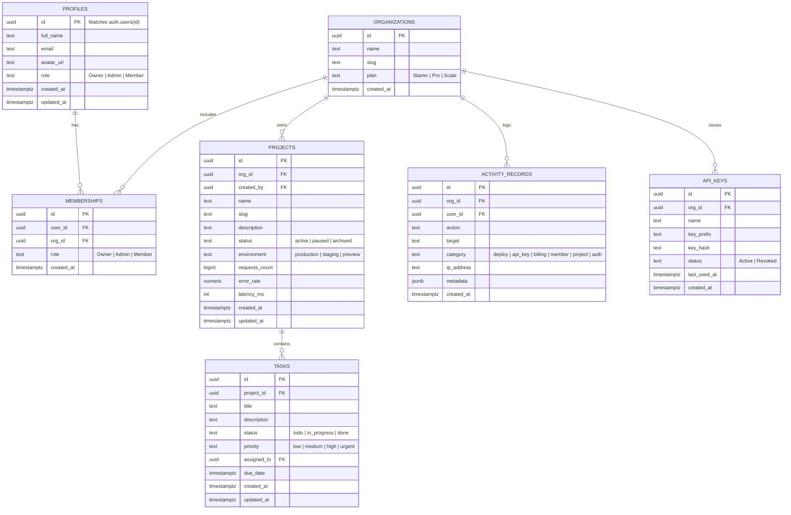

# Veyrix — Supabase Auth & PostgreSQL Integration Guide
> **Brand:** Veyrix  
> **Tagline:** Build beyond limits.

This directory contains the database schema migrations, Row Level Security (RLS) policies, and triggers for the Veyrix SaaS platform.

---

## 1. Environment Setup

Copy `.env.example` to `.env.local` in the project root:

```bash
cp .env.example .env.local
```

Populate the required credentials from your **[Supabase Dashboard](https://supabase.com/dashboard)**:

```env
# 1. Supabase Project Settings > API > Project URL
NEXT_PUBLIC_SUPABASE_URL=https://your-project-ref.supabase.co

# 2. Supabase Project Settings > API > Project API Keys > anon (public)
NEXT_PUBLIC_SUPABASE_ANON_KEY=eyJhbGciOi...

# 3. Supabase Project Settings > API > Project API Keys > service_role (secret)
# IMPORTANT: Never commit or expose this key to client-side code!
SUPABASE_SERVICE_ROLE_KEY=eyJhbGciOi...

# 4. Application URL for redirects
NEXT_PUBLIC_APP_URL="http://localhost:3000"
```

> **Note on Local Development (Hybrid Demo Mode):**  
> If `NEXT_PUBLIC_SUPABASE_URL` is omitted, the application runs in seeded Dev/Demo mode with full offline interactive testing capabilities and one-click demo login shortcuts. Once you paste your live keys into `.env.local`, the application seamlessly switches to live Supabase Auth and PostgreSQL.

---

## 2. Applying Database Migrations

You can apply the schema to your Supabase PostgreSQL database using either method below:

### Option A: Supabase Dashboard (Quickest)
1. Open your project at [database.new](https://database.new) or [supabase.com/dashboard](https://supabase.com/dashboard).
2. Go to the **SQL Editor** in the left navigation sidebar.
3. Click **New Query**.
4. Copy the entire contents of [`supabase/migrations/20261011_saas_schema.sql`](./migrations/20261011_saas_schema.sql) and paste it into the editor.
5. Click **Run** (or press `Cmd+Enter` / `Ctrl+Enter`).
6. You will see: `Success. No rows returned`.

### Option B: Supabase CLI
```bash
# Link your local project to your remote Supabase instance
npx supabase link --project-ref your-project-ref

# Push migrations to remote database
npx supabase db push
```

---

## 3. Database Schema Overview



---

## 4. Row Level Security (RLS) & Multi-Tenant Isolation

1. **User Profiles:** Users can only modify their own profile record (`auth.uid() = id`), and read teammate profiles within shared organizations.
2. **Organization Isolation:** Every query on `projects`, `tasks`, `activity_records`, and `api_keys` strictly joins with `memberships` ensuring users cannot query or tamper with data belonging to other organizations.
3. **Role-Based Authority:** 
   - **Members:** Can view project metrics and manage assigned tasks.
   - **Admins & Owners:** Can create projects, invite team members, generate/revoke API keys, and update organization settings.
   - **Owners:** Exclusive authority over organization deletion and billing tiers.

---

## 5. Auth Configuration Checklist in Supabase

In the **Supabase Dashboard > Authentication > URL Configuration**:
1. **Site URL:** Set to `http://localhost:3000` (or your production domain).
2. **Redirect URLs:** Add:
   - `http://localhost:3000/api/auth/callback`
   - `http://localhost:3000/reset-password`
   - `http://localhost:3000`
